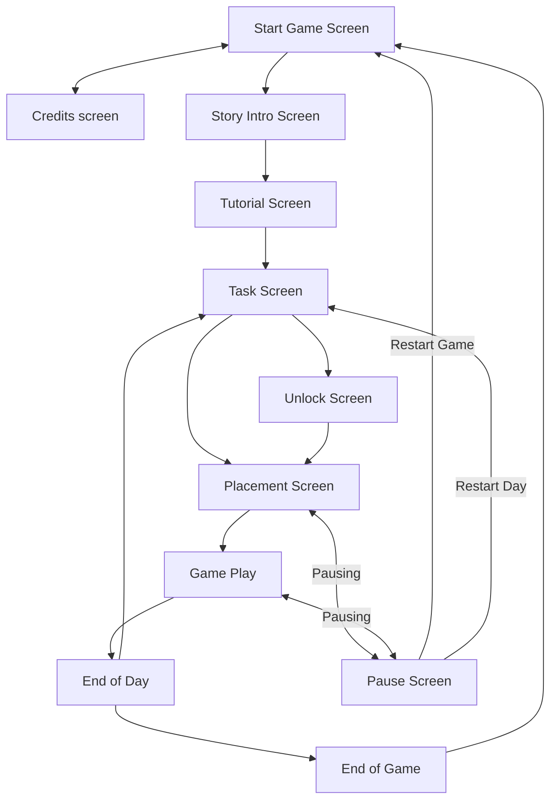
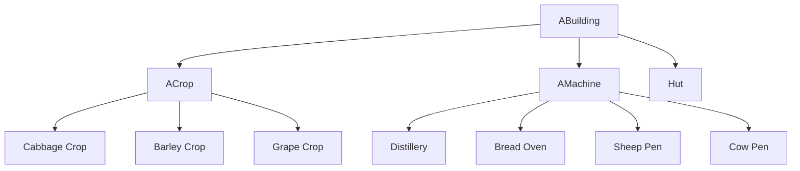

# [To be King](https://github.com/nickolasddiaz/To-be-King)

Game Jam/Expo Project Florida Poly Fall 2026

## Tool Used

Godot 4.7.2.stable.mono using C#

[AsepriteWizard](https://godotengine.org/asset-library/asset/713): Asesprite is needed to import assets

VScode Extensions:

- [.NET Install Tool](https://marketplace.visualstudio.com/items?itemName=ms-dotnettools.vscode-dotnet-runtime)
- [Godot .NET Tools](https://marketplace.visualstudio.com/items?itemName=woberg.godot-dotnet-tools)

## Team

- Alexander Ramirez
- Mateus Ramos
- Nicolas Diaz
- Nickolas Diaz

## Commands

CSharpier: code formatter for C#

CSharpier check

```bash
dotnet csharpier check .
```

CSharpier format

```bash
dotnet csharpier format .
```

roslynator: linter for Godot C#

```bash
dotnet tool run roslynator analyze project.sln
```

## File Structure

```bash
To-be-King $tree -a -L 1
├── .editorconfig       # rules for the roslynator linter
├── .git                # git folder 
├── .gitattributes      # remove GDScript for the list of languages shown
├── .gitignore          # prevent files/folders from being commited
├── .godot/             # Godot's cache directory
├── .vscode/            # Settings for the VScode editor, allows for debugging, and make files hidden from view
├── Assets/             # Aseprite/SpriteFrames assets
├── Audio/              # Audio folder
├── Global Scripts /    # Global scripts that can be access anywhere in the project
├── Scenes/             # scene files with their corresponding .cs scripts
├── addons/             # Godot addon folder location
├── README.md           # Documentation/description of this project 
├── dotnet-tools.json   # Config file for the C# tools like csharpier and roslynator
├── project.csproj      # C# solution file
├── project.godot       # Godot settings file
└── project.sln         # C# solution file
```

## Diagram of the Game

### Screen Management



### Building Hierarchy

Using inherited scenes and abstract classes



## About

The game is inspired by the **King and the Beggar parable** and the game **[Ranch Rush 2](https://www.bigfishgames.com/blog/walkthroughs/ranch-rush-2-collectors-edition.html)**

**Game genre:** medieval time-management  

## Story

A king who has no heir decides to find a successor, declares a royal mandate.

The aging king declares a kingdom-wide competition to find his successor. The young men of the land are tasked with a trial, whoever can cultivate the most impressive plot of crops/food over a set timeframe will inherit the throne.

The trial will last 5-7 days; each day requires a certain threshold of food to be grown/harvested.

On several days there will be an optional quest of kindness (set up by the king as a test of kindness, the metric he will choose as an heir), like helping a beggar by feeding him food. This act of kindness will obviously be a challenge and will reduce farming time.  If the player fails to get enough yield in the harvest, they must restart the day. On the last day, the king will be disguised as a common traveler. The "stranger" pretends to be lost and asks the player for directions to the king's palace. (Only appears if you did every kindness event).

Bad ending: The player was not selected to be the king, and states that another commoner has been selected because they showed kindness despite their trial. The true metric is kindness; perhaps you would be chosen if you showed some.

Good ending: The player completed all kindness quests. They were chosen to be kings. By prioritizing compassion and helping strangers, the player proved he possessed the true heart of a ruler.

## Gameplay

It will be 2D top-down, also could be 3D

Buildings: Are placed in a square grid pattern

Main hut: this is the building that when the player goes to deliver each food product

Crops tile: Can plant crops  

Animal Cage: Can store animals, that produce a product i.e. wool/milk needs wheat for the animal to eat and produce product

Machines: Can turn products into processed products like milk into cheese, of course it would take a while to produce it

Movement: there is no WSD normal movement instead the buildings are clicked, and the player moves to it. The movements are indicated by an arrow and they are queueable, pressing esc key will remove the movement queue.

### Screens

Manage farm screen: Between each day/level there will be a placement screen where the player can buy new buildings and move existing ones in the grid system.

Start of day screen: Shows the required amount of produce to pass the day.

Time limit for each day is two to five minutes

### List of unlocks

| Building Name | Produces  | Takes                     | Costs |
|---------------|-----------|---------------------------|-------|
| Barley crop   | Barley    | N/A                       | 100   |
| Cabbage crop  | Cabbage   | N/A                       | 150   |
| Grape crop    | Grape     | N/A                       | 500   |
| Sheep pen     | Wool      | 3 Barley                  | 500   |
| Cow pen       | Milk      | 3 Barley                  | 500   |
| Bread Oven    | Bread     | 3 Barley                  | 2000  |
| Distillery    | Ale, Wine | 2 Barley2 Grapes + Barley | 3000  |

### Day

| Day | Product Requirement                                                          | Unlockable buildings, seeds, animals | Money given at the end of day | Kindness quest                                       |
|-----|------------------------------------------------------------------------------|--------------------------------------|-------------------------------|------------------------------------------------------|
| 1   | 10 barleys                                                                   | Tutorial barley crop                 | 300                           |                                                      |
| 2   | 10 barleys 10 cabbages                                                       | Cabbage crop                         | 600                           |                                                      |
| 3   | 8 barleys 8 cabbages 2 wools                                                 | Sheep pen                            | 1000                          | Give the beggar 2 barleys 2 cabbages                 |
| 4   | 4 cabbages 4 wools 4 milks                                                   | Cow pen                              | 2000                          |                                                      |
| 5   | 4 breads4 milks4 wools4 barleys                                              | Bread oven                           | 3000                          | Give 2 buckets of milk to the passing caravan        |
| 6   | 5 ales 4 milks 4 wools 5 cabbages                                            | Distillery                           | 4000                          |                                                      |
| 7   | 10 grapes8 cabbages4 ales                                                    | Grapes                               | 5000                          |                                                      |
| 8   | 10 barleys 10 cabbages 10 grapes 10 wools 10 milks 10 breads10 ales 10 wines |                                      | Game finished                 | Help the disguised king to palace (costs 30 seconds) |

## Details about the art

The color pallet should be consistent with the project

We will use Asprite and we will use the Asprite plugin to manage the assets

Width x Height:

- The map should be 640x360 pixels

- Each tile should be 32x32 pixels

List of buildings:

- Hut: 2x2 tiles

- Crop tile: 1x1 tile

- Animal pen: 2x1 tiles

- Bread oven: 2x1 tiles

- Distillery: 2x1 tiles

List of sprites to draw:

- Player: animated sprite for running and idle

- Hut: one sprite

- Base crop tile: one sprite

- Barleys crop tile: 2-3 sprites; 1 starting to grow; 1 almost grown; 1 finished growing

- Cabbage crop tile: 2-3 sprites; 1 starting to grow; 1 almost grown; 1 finished growing

- Grape crop tile: 2-3 sprites; 1 starting to grow; 1 almost grown; 1 finished growing

- Animal pen: 6 sprites; 1 with cow; 1 with sheep; 1 with sheep without wool; 1 with filled wool in its product spot; 1 with a milk jar in its product spot, 1 with barley in its feed spot

- Bread oven: 4 sprites; 1 empty, 1 cooking up with fire; 1 with barley in its feed spot, 1 with bread in its product spot

- Distillery: 7 sprites; 1 empty; 1 producing wine, 1 producing ale, 1 with grapes in its feed slot, 1 with barely in its feed slot, 1 with wine in its product spot, 1 with ale in its product spot

- One icon for each building except hut: 8 sprites; base crop, barley seed, cabbage seed, grape seed, animal pen with sheep, animal pen with cow, bread oven, and distillery. This is icons for the buy screen

- 8 icons for products: barleys, cabbages, grapes, wools, milks, breads, ales, wines

- Quests: 3 sprites; beggar, caravan, king

Theme:

- Create a Godot theme to style the UI elements

## Placement UI System

Tracing placement: tracking the mouse position, snapping it to a grid coordinate using a TileMapLayer

1. Get the mouse position relative to the TileMapLayer

Vector2 localMousePos = TileMapLayer.GetLocalMousePosition();

1. Convert that position to map/grid coordinates

Vector2i mapCoords = TileMapLayer.LocalToMap(localMousePos);

1. Convert the map coordinates back into local/world positions to snap to the cell

Vector2 snappedLocalPos = TileMapLayer.MapToLocal(mapCoords);

1. Update the sprite’s global position

Sprite.GlobalPosition = TargetTileMapLayer.ToGlobal(snappedLocalPos);

[Quick Tutorial](https://www.youtube.com/watch?v=z3RDS3s0Oz8&t=141s)

Edge cases:

- Detect invalid placements through ray casting to an area

- Having modes such as buy, move, and delete

- Multiple sized title systems like 1x1, 2x1, and 4x4

Use of packed scenes to manage all the buildings:

It will override the number of tiles, and costs of money, input handler of the player when the player touches the building (ie taking resources from the player).

It will handle what sprite to draw, how and when each resource is produced

## Level System

It will be a list of dictionaries/classes for each day

What each day will have:

- Product requirements i.e. 10 barely, 10 cabbages
- Unlockable buildings
- How much money is given at every day
- What kindness quest is shown

## Movement System

No normal WSAD movement

Instead, the player will left click a building, and the player will go to it

It can also be queued and right clicking will destroy the queue

Implementation:

In the global script it will have a queue that stores a list of buildings, every time a building is clicked the building itself will add its own reference to the queue

The player will run to the building’s position and execute the handle for the building passing the reference to the player so the building can be handled
