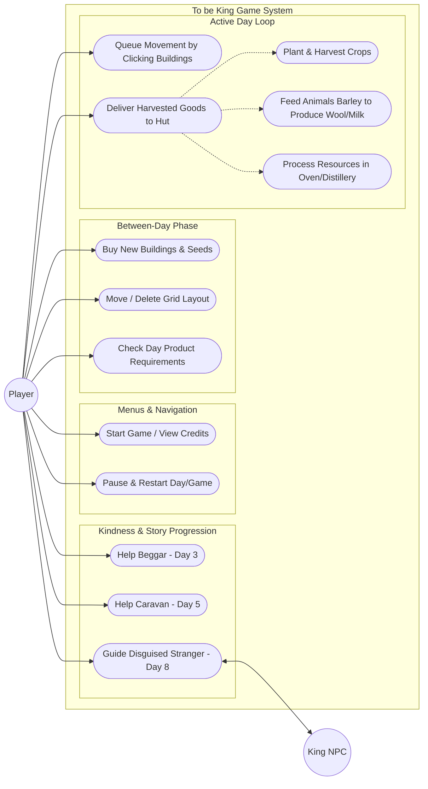
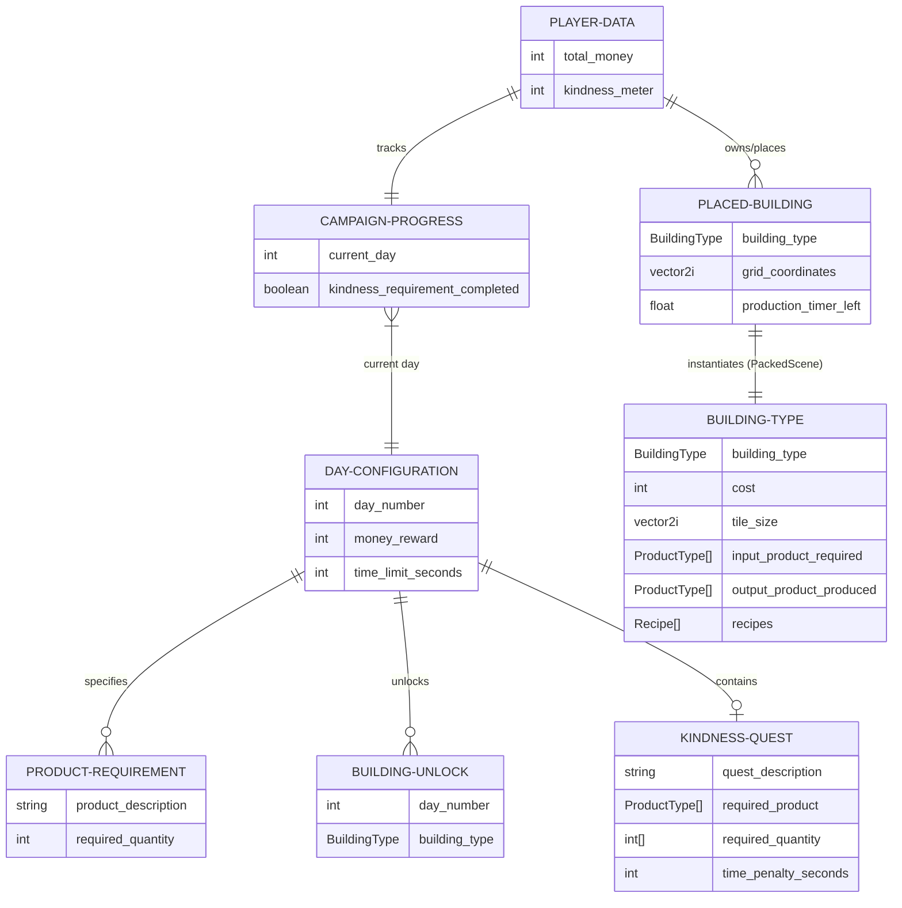
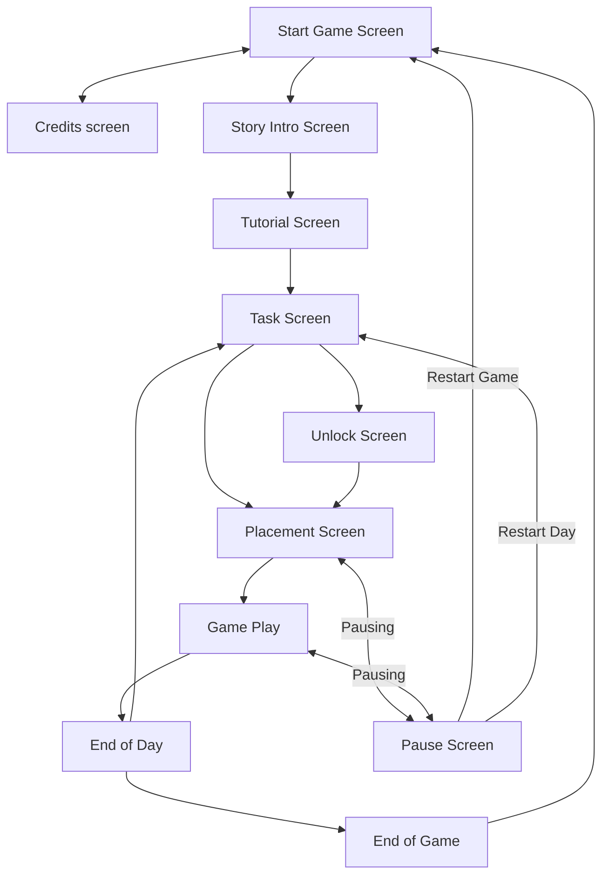
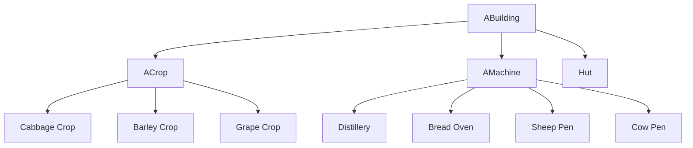

# [To be King](https://github.com/nickolasddiaz/To-be-King)

Game Jam/Expo Project Florida Poly Fall 2026

## Tool Used

Godot 4.7.2.stable.mono using C#

[AsepriteWizard](https://godotengine.org/asset-library/asset/1572): Asesprite is needed to import assets

VScode Extensions:

- [.NET Install Tool](https://marketplace.visualstudio.com/items?itemName=ms-dotnettools.vscode-dotnet-runtime)
- [Godot .NET Tools](https://marketplace.visualstudio.com/items?itemName=woberg.godot-dotnet-tools)

## Team

- Alexander Ramirez
- Mateus Ramos
- Nicolas Diaz
- Nickolas Diaz

## Commands

CSharpier: code formatter for C#

CSharpier check

```bash
dotnet csharpier check .
```

CSharpier format

```bash
dotnet csharpier format .
```

roslynator: linter for Godot C#

```bash
dotnet tool run roslynator analyze project.sln
```

## File Structure

```bash
To-be-King $tree -a -L 1
├── .editorconfig       # rules for the roslynator linter
├── .git                # git folder 
├── .gitattributes      # remove GDScript for the list of languages shown
├── .gitignore          # prevent files/folders from being commited
├── .godot/             # Godot's cache directory
├── .vscode/            # Settings for the VScode editor, allows for debugging, and make files hidden from view
├── Assets/             # Aseprite/SpriteFrames assets
├── Audio/              # Audio folder
├── Global Scripts /    # Global scripts that can be access anywhere in the project
├── Scenes/             # scene files with their corresponding .cs scripts
├── addons/             # Godot addon folder location
├── README.md           # Documentation/description of this project 
├── dotnet-tools.json   # Config file for the C# tools like csharpier and roslynator
├── project.csproj      # C# solution file
├── project.godot       # Godot settings file
└── project.sln         # C# solution file
```

## About

The game is inspired by the **King and the Beggar parable** and the game **[Ranch Rush 2](https://www.bigfishgames.com/blog/walkthroughs/ranch-rush-2-collectors-edition.html)**

**Game genre:** medieval time-management  

## Story

A king who has no heir decides to find a successor, declares a royal mandate.

The aging king declares a kingdom-wide competition to find his successor. The young men of the land are tasked with a trial, whoever can cultivate the most impressive plot of crops/food over a set timeframe will inherit the throne.

The trial will last 5-7 days; each day requires a certain threshold of food to be grown/harvested.

On several days there will be an optional quest of kindness (set up by the king as a test of kindness, the metric he will choose as an heir), like helping a beggar by feeding him food. This act of kindness will obviously be a challenge and will reduce farming time.  If the player fails to get enough yield in the harvest, they must restart the day. On the last day, the king will be disguised as a common traveler. The "stranger" pretends to be lost and asks the player for directions to the king's palace. (Only appears if you did every kindness event).

Bad ending: The player was not selected to be the king, and states that another commoner has been selected because they showed kindness despite their trial. The true metric is kindness; perhaps you would be chosen if you showed some.

Good ending: The player completed all kindness quests. They were chosen to be kings. By prioritizing compassion and helping strangers, the player proved he possessed the true heart of a ruler.

## Gameplay

It will be 2D top-down, also could be 3D

Buildings: Are placed in a square grid pattern

Main hut: this is the building that when the player goes to deliver each food product

Crops tile: Can plant crops  

Animal Cage: Can store animals, that produce a product i.e. wool/milk needs wheat for the animal to eat and produce product

Machines: Can turn products into processed products like milk into cheese, of course it would take a while to produce it

Movement: there is no WSD normal movement instead the buildings are clicked, and the player moves to it. The movements are indicated by an arrow and they are queueable, pressing esc key will remove the movement queue.

### Screens

Manage farm screen: Between each day/level there will be a placement screen where the player can buy new buildings and move existing ones in the grid system.

Start of day screen: Shows the required amount of produce to pass the day.

Time limit for each day is two to five minutes

### List of unlocks

| Building Name | Produces  | Takes                     | Costs |
|---------------|-----------|---------------------------|-------|
| Barley crop   | Barley    | N/A                       | 100   |
| Cabbage crop  | Cabbage   | N/A                       | 150   |
| Grape crop    | Grape     | N/A                       | 500   |
| Sheep pen     | Wool      | 3 Barley                  | 500   |
| Cow pen       | Milk      | 3 Barley                  | 500   |
| Bread Oven    | Bread     | 3 Barley                  | 2000  |
| Distillery    | Ale, Wine | 2 Barley2 Grapes + Barley | 3000  |

### Day

| Day | Product Requirement                                                          | Unlockable buildings, seeds, animals | Money given at the end of day | Kindness quest                                       |
|-----|------------------------------------------------------------------------------|--------------------------------------|-------------------------------|------------------------------------------------------|
| 1   | 10 barleys                                                                   | Tutorial barley crop                 | 300                           |                                                      |
| 2   | 10 barleys 10 cabbages                                                       | Cabbage crop                         | 600                           |                                                      |
| 3   | 8 barleys 8 cabbages 2 wools                                                 | Sheep pen                            | 1000                          | Give the beggar 2 barleys 2 cabbages                 |
| 4   | 4 cabbages 4 wools 4 milks                                                   | Cow pen                              | 2000                          |                                                      |
| 5   | 4 breads4 milks4 wools4 barleys                                              | Bread oven                           | 3000                          | Give 2 buckets of milk to the passing caravan        |
| 6   | 5 ales 4 milks 4 wools 5 cabbages                                            | Distillery                           | 4000                          |                                                      |
| 7   | 10 grapes8 cabbages4 ales                                                    | Grapes                               | 5000                          |                                                      |
| 8   | 10 barleys 10 cabbages 10 grapes 10 wools 10 milks 10 breads10 ales 10 wines |                                      | Game finished                 | Help the disguised king to palace (costs 30 seconds) |

## Details about the art

The color pallet should be consistent with the project

We will use Asprite and we will use the Asprite plugin to manage the assets

Width x Height:

- The map should be 960x540 pixels
- Each tile should be 32x32 pixels

List of buildings:

- Hut: 2x2 tiles
- Crop tile: 1x1 tile
- Animal pen: 2x1 tiles
- Bread oven: 2x1 tiles
- Distillery: 2x1 tiles

List of sprites to draw:

- Player: animated sprite for running and idle
- Hut: one sprite
- Base crop tile: one sprite
- Barleys crop tile: 2-3 sprites; 1 starting to grow; 1 almost grown; 1 finished growing
- Cabbage crop tile: 2-3 sprites; 1 starting to grow; 1 almost grown; 1 finished growing
- Grape crop tile: 2-3 sprites; 1 starting to grow; 1 almost grown; 1 finished growing
- Animal pen: 6 sprites; 1 with cow; 1 with sheep; 1 with sheep without wool; 1 with filled wool in its product spot; 1 with a milk jar in its product spot, 1 with barley in its feed spot
- Bread oven: 4 sprites; 1 empty, 1 cooking up with fire; 1 with barley in its feed spot, 1 with bread in its product spot
- Distillery: 7 sprites; 1 empty; 1 producing wine, 1 producing ale, 1 with grapes in its feed slot, 1 with barely in its feed slot, 1 with wine in its product spot, 1 with ale in its product spot
- One icon for each building except hut: 8 sprites; base crop, barley seed, cabbage seed, grape seed, animal pen with sheep, animal pen with cow, bread oven, and distillery. This is icons for the buy screen
- 8 icons for products: barleys, cabbages, grapes, wools, milks, breads, ales, wines
- Quests: 3 sprites; beggar, caravan, king

Theme:

- Create a Godot theme to style the UI elements

## Placement UI System

Tracing placement: tracking the mouse position, snapping it to a grid coordinate using a TileMapLayer

1. Get the mouse position relative to the TileMapLayer
    Vector2 localMousePos = TileMapLayer.GetLocalMousePosition();
2. Convert that position to map/grid coordinates
    Vector2i mapCoords = TileMapLayer.LocalToMap(localMousePos);
3. Convert the map coordinates back into local/world positions to snap to the cell
    Vector2 snappedLocalPos = TileMapLayer.MapToLocal(mapCoords);
4. Update the sprite’s global position
    Sprite.GlobalPosition = TargetTileMapLayer.ToGlobal(snappedLocalPos);

[Quick Tutorial](https://www.youtube.com/watch?v=z3RDS3s0Oz8&t=141s)

Edge cases:

- Detect invalid placements through ray casting to an area
- Having modes such as buy, move, and delete
- Multiple sized title systems like 1x1, 2x1, and 4x4

Use of packed scenes to manage all the buildings:

It will override the number of tiles, and costs of money, input handler of the player when the player touches the building (ie taking resources from the player).

It will handle what sprite to draw, how and when each resource is produced

## Level System

It will be a list of dictionaries/classes for each day

What each day will have:

- Product requirements i.e. 10 barely, 10 cabbages
- Unlockable buildings
- How much money is given at every day
- What kindness quest is shown

## Movement System

No normal WSAD movement

Instead, the player will left click a building, and the player will go to it

It can also be queued and right clicking will destroy the queue

Implementation:

In the global script it will have a queue that stores a list of buildings, every time a building is clicked the building itself will add its own reference to the queue

The player will run to the building’s position and execute the handle for the building passing the reference to the player so the building can be handled

## Software Engineering Document

### Phase 1: Create a list of requirements defining your game

| Requirements Number | Requirement                                                                                                                                                                                                                                                                                                                                                                                                                                                   |
|---------------------|---------------------------------------------------------------------------------------------------------------------------------------------------------------------------------------------------------------------------------------------------------------------------------------------------------------------------------------------------------------------------------------------------------------------------------------------------------------|
| R001[1]             | The user will be able to place, move and sell buildings. A grid of squares will be shown indicating where valid placements are. A green indicator will shown for a valid placement. A red indicator will be shown for an invalid placement. The user will only be able to place buildings that they have unlocked and can afford to purchase.                                                                                                                 |
| R002[1]             | The user will be shown how many products they need to achieve to pass the level/day. This display will be updated every time the products are updated. It will not show products that are not unlocked.                                                                                                                                                                                                                                                       |
| R003[1]             | The user will be shown a description of the newly unlocked building. It will show what items it takes in and items it outputs.                                                                                                                                                                                                                                                                                                                                |
| R004[1]             | The user will be able to select a building and go towards buildings. When the player reaches the building, it will take/give from the player's inventory.                                                                                                                                                                                                                                                                                                     |
| R005[1]             | The buildings will need a robust recipe system that can handle taking/giving from a player's inventory. It will handle drawing the items it has based on the state of the building's inventory. If a recipe is fulfilled it will produce an output after a certain amount of time.                                                                                                                                                                            |
| R006[1]             | A robust screen manager is needed to transition from different scenes.  For example moving from the start of the game to the task screen to the placement manager and the gameplay.                                                                                                                                                                                                                                                                           |
| R007[1]             | A system of tracking the state/data of the days. Every day there is a list of products to work for, a building unlock, the amount of time to complete and a dialog.                                                                                                                                                                                                                                                                                           |
| R008[1]             | The player will not use the typical WASD to move around. Instead it will be a queue based system where the player will left click a building and the player will go to that building. The clicks are stackable, clicking multiple buildings will make the player go to all the selected buildings. Right clicking anywhere will remove the queue of selections. If a building is selected an arrow will be drawn indicating that the player has selected  it. |
| R009[1]             | The map of the game will be 960 x 540 pixels and the building icons will be 32x32 pixels per tile and the product icons will be 16x16 pixels.                                                                                                                                                                                                                                                                                                                 |
| R010[1]             | A timer will be shown indicating the amount of time a player has until the end of the day.                                                                                                                                                                                                                                                                                                                                                                    |
| R011[2]             | A pause menu screen will be shown if the player presses escape or presses the pause screen icon. It will need to pause the game time. The menu will consist of continue/unpause, restart the day, and restart the game.                                                                                                                                                                                                                                       |
| R012[2]             | Optional quests will be given over the course of the game. The quests will require the player to sacrifice a certain amount of resources or time to complete. At the end of the game the good/bad ending will occur depending on if the player did the kindness quests.                                                                                                                                                                                       |
| R013[2]             | A robust sound manager will be needed to play the background music and sfx sounds. It will be called during each ui interaction.                                                                                                                                                                                                                                                                                                                              |
| R014[2]             | A godot ui theme will be created to reflect the medieval theme of the game.                                                                                                                                                                                                                                                                                                                                                                                   |
| R015[2]             | A banner for the game will be created for the start screen, depicting the king and the jester.  Two more artworks are needed for the good and bad endings of the game.                                                                                                                                                                                                                                                                                        |
| R016[3]             | More specialized buildings like a bee hive that will attack/stun players from time to time                                                                                                                                                                                                                                                                                                                                                                    |
| R017[3]             | A robust tutorial screen indicated exactly how the player plays the game. It guides the player through foundational interaction in the game.                                                                                                                                                                                                                                                                                                                  |
| R018[3]             | Upgrades screen if the player has enough money they can upgrade the size of their inventory, or speed of buildings.                                                                                                                                                                                                                                                                                                                                           |
| R019[3]             | A mini-game screen that allows bonus rewards for as much product that the player can achieve.                                                                                                                                                                                                                                                                                                                                                                 |
| R020[3]             | A trophy/screenshot of the game if the player wins the game.                                                                                                                                                                                                                                                                                                                                                                                                  |

### Phase 2: Create a use-case diagram



### Phase 3: Create a Requirements fulfillment diagram

|          | **UCS-001** | **UCS-002** | **UCS-003** | **UCS-0014** | **UCS-005** | **UCS-006** | **UCS-007** | **UCS-008** | **UCS-009** | **UCS-010** | **UCS-011** | **UCS-012** | **UCS-013** | **UCS-014** | **UCS-015** |
|:--------:|:-----------:|:-----------:|:-----------:|:------------:|:-----------:|:-----------:|:-----------:|:-----------:|:-----------:|:-----------:|:-----------:|:-----------:|:-----------:|:-----------:|:-----------:|
| **R001** |      X      |      X      |      X      |              |             |             |             |             |             |             |             |             |             |             |             |
| **R002** |             |             |             |              |             |             |             |      X      |             |             |             |             |             |             |             |
| **R003** |             |             |      X      |              |             |             |             |             |             |             |             |             |             |             |             |
| **R004** |             |             |             |       X      |      X      |             |      X      |             |             |             |             |             |             |             |             |
| **R005** |             |             |             |              |             |             |      X      |             |             |             |             |             |             |             |             |
| **R006** |             |             |             |              |             |             |             |             |             |             |      X      |             |             |             |             |
| **R007** |             |             |             |              |             |             |             |             |             |             |             |      X      |             |             |             |
| **R008** |             |             |             |       X      |      X      |      X      |             |             |             |             |             |             |             |             |             |
| **R009** |             |             |             |              |             |             |             |             |             |             |             |             |             |             |             |
| **R010** |             |             |             |              |             |             |             |             |             |             |      X      |      X      |             |             |             |
| **R011** |             |             |             |              |             |             |             |             |             |             |             |             |      X      |             |             |
| **R012** |             |             |             |              |             |             |             |             |      X      |      X      |             |             |             |      X      |      X      |
| **R013** |             |             |             |              |             |             |             |             |             |             |             |             |             |             |             |
| **R014** |             |             |             |              |             |             |             |             |             |             |             |             |      X      |             |             |
| **R015** |             |             |             |              |             |             |             |             |             |             |             |             |             |      X      |      X      |
| **R016** |             |             |             |              |             |             |             |             |             |             |             |             |             |             |             |
| **R017** |             |             |             |              |             |             |             |             |             |             |             |             |             |             |             |
| **R018** |             |             |             |              |             |             |             |             |             |             |             |             |             |             |             |
| **R019** |             |             |             |              |             |             |             |             |             |             |             |             |             |             |             |
| **R020** |             |             |             |              |             |             |             |             |             |             |             |             |             |             |             |

### Phase 4: Create enough use-case scenarios to fulfill each requirement

| **Scenario Id** | **Use Case**   | **Preconditions**                                                                              | **Outcome**                                                          | **Postconditions**                                                                  | **Requirements** |
|-----------------|----------------|------------------------------------------------------------------------------------------------|----------------------------------------------------------------------|-------------------------------------------------------------------------------------|------------------|
| UCS-001         | Grid Placement | Player attempts to place an unlocked building they can afford on an empty tile.                | Grid displays a green indicator                                      | Building successfully snaps to the grid and subtracts money.                        | R001             |
| UCS-002         | Grid Placement | Player attempts to place an unlocked building they can afford over an existing building.       | Grid displays a red indicator                                        | Placement is blocked.                                                               | R001             |
| UCS-003         | Grid Placement | Player tries to buy a locked building or one they cannot afford.                               | Building is not selected                                             | Error sound is played                                                               | R001, R003       |
| UCS-004         | Movement       | Player left-clicks a single building during gameplay.                                          | An arrow is drawn indicating selection                               | Player character moves directly to the building.                                    | R004, R008       |
| UCS-005         | Movement       | Player left-clicks Building A, then Building B, then Building C in succession.                 | Three arrows are drawn on the buildings                              | Player character moves to A, executes its logic, then moves to B, then C.           | R004, R008       |
| UCS-006         | Movement       | Player has 2 buildings queued up and right-clicks anywhere on the screen.                      | All movement selection arrows disappear                              | the player's movement queue is completely cleared.                                  | R008             |
| UCS-007         | Inventory      | Player reaches a machine building (e.g., Distillery) with required raw materials in inventory. | The machine takes the ingredients from the player's inventory.       | Displays its processing state, and the machine takes time to process the materials. | R004, R005       |
| UCS-008         | Inventory      | Player reaches a finished building (e.g., grown Crop or finished Bread Oven).                  | The building delivers the output product into the player's inventory | Updates its graphic back to empty/unharvested.                                      | R002             |
| UCS-009         | Progression    | Player collects a required level product (e.g., harvests 1 of 10 Barleys).                     | The UI counter instantly updates (e.g., from 0/10 to 1/10).          | The player sees the UI update.                                                      | R012             |
| UCS-010         | Quests         | A kindness quest appears, and the player chooses to sacrifice the requested resources or time. | Resources are removed from inventory (or time is subtracted)         | A flag is set tracking that this optional quest was completed.                      | R012             |
| UCS-011         | Game State     | The level timer reaches zero, and the player has met all product quotas.                       | Gameplay scene transitions to the "End of Day" scene                 | The next day/task is unlocked.                                                      | R006, R010       |
| UCS-012         | Game State     | The level timer reaches zero, but the player is short on required products.                    | A day-failed sequence triggers.                                      | The player has to restart the day.                                                  | R007, R010       |
| UCS-013         | Game State     | Player presses ESC or the pause button during intense gameplay.                                | The pause UI is shown.                                               | Game clock completely freezes.                                                      | R011, R014       |
| UCS-014         | Endings        | Player finishes the last day having successfully completed all optional kindness quests.       | Game transitions to the Good Ending                                  | Artwork scene depicting the player chosen as the new king.                          | R012, R015       |
| UCS-015         | Endings        | Player finishes the last day but skipped one or more kindness quests.                          | Game transitions to the Bad Ending                                   | Artwork scene showing another commoner chosen for their kindness.                   | R012, R015       |

### Phase 5: Create an ORD diagram with the class relationships



### Phase 6: Create a formal class diagram from the ORD

#### Screen Management



#### Building Hierarchy

Using inherited scenes and abstract classes

Abstract Methods/Variables:

- interactWithPlayer
- Interact
- InputInventory
- outputInventory
- recipes
- buildingType
- Size
- Cost
- draw


